<div align="center">

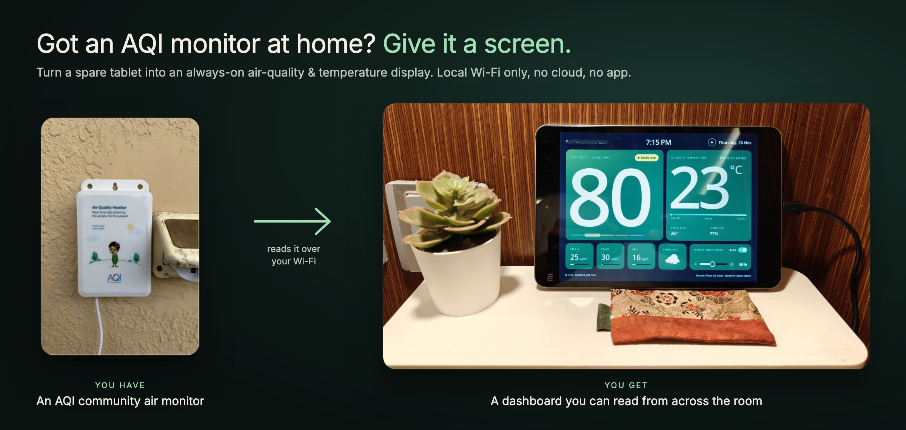

# AQI Dashboard

**Turn a spare tablet into an always-on air quality and temperature display for your home.**

It reads the monitor you already own over your Wi-Fi. No cloud account, no app, no subscription.

[Quick start](#quick-start-two-prompts) · [Presets](#presets) · [Devices](#supported-devices) · [How it works](#how-it-works) · [Configuration](#configuration)


</div>

---

<p align="center">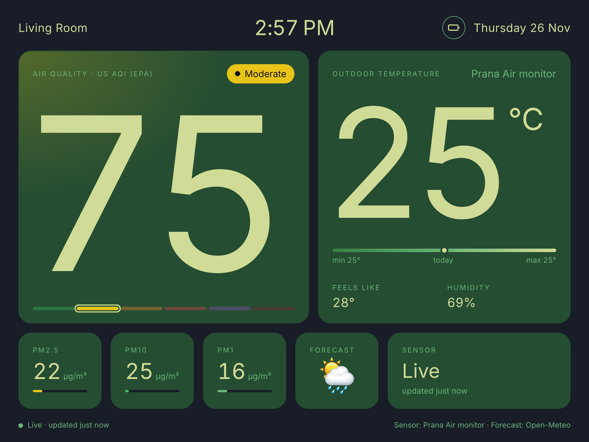</p>

## Quick start: two prompts

This project is designed to be set up **by your own AI agent**: Claude Code, Codex, Cursor, Hermes, or any agent that can run shell commands on a computer on your home network.

Copy a prompt, fill in the `<...>` parts, and paste it in. Each prompt makes the agent show evidence (raw readings, `curl` output, a screenshot), so you can trust that it actually worked.

> Prefer doing it by hand? Each step links to the manual instructions.

### Step 1: Connect to your air quality monitor

Run this on a computer on the **same network** as the monitor.

```text
Help me connect my home air-quality monitor to the self-hosted dashboard at
https://github.com/asispan/aqi-dashboard. Work step by step and show me evidence
(command output) for every step.

My monitor: <brand and model, e.g. "Prana Air / Bohu Monitor">. It is on my home Wi-Fi.
Where it sits: <outdoors on the balcony | indoors>.
My city (for sunrise/sunset and the forecast): <city>.

1. FIND IT. List this machine's network interfaces and subnets. Look for the monitor via
   the ARP table, mDNS (_http._tcp), and a port-80 sweep of each local subnet, looking for
   a page that mentions the brand, "PM2.5" or "AQI". IoT devices are often on a separate
   VLAN/subnet: if you find nothing, ask me for the router's client list or the IoT subnet.
2. READ IT. Prana Air / Bohu monitors serve readings at GET http://<ip>/data (HTML).
   Fetch it, show the raw response, and extract PM2.5, PM1, PM10, temperature, humidity
   and CO2. Read it twice, 60 seconds apart, to prove the values are live.
   If my monitor is a different brand: find its local HTTP/JSON endpoint (or its Home
   Assistant / MQTT entity). If it serves JSON, use monitor.type "json" with a fields map;
   otherwise add a small adapter to ADAPTERS in app/server.py returning
   pm25, pm1, pm10, temp, hum, co2.
3. KEEP IT STABLE. Tell me the monitor's MAC address and recommend a DHCP reservation on my
   router so its IP never changes. Do not change router settings yourself.
4. CONFIGURE. Clone the repo, copy app/config.example.json to app/config.json, and set:
   monitor.url, monitor.name, home_name (e.g. "Living Room"), temp_label
   ("Outdoor temperature" or "Indoor temperature"), and location.lat/lon (city-level).
5. VERIFY. Run `python3 app/server.py`, then
   `curl -s http://127.0.0.1:8787/api/state` and show me that pm25 is present and the
   reading timestamp is less than 2 minutes old. Open http://127.0.0.1:8787/ and show me a
   screenshot.

Rules: talk to the monitor with GET requests only. Never submit its Wi-Fi setup page,
never reset or re-provision it, and keep port 8787 on the local network only.
Finish with: monitor IP + MAC, endpoint, one sample reading, and my final config.json.
```

<sub>Manual route: [`app/config.example.json`](app/config.example.json) · adapters live in [`app/server.py`](app/server.py)</sub>

### Step 2: Turn your tablet into the dashboard

Run this right after Step 1, with the same agent.

```text
Continue from Step 1. Now make my tablet a permanent, full-screen, always-on display of
the aqi-dashboard, with presets, following the guides in the repo's deploy/ folder.

Target device: <e.g. "iPad 10th gen" | "Samsung Galaxy Tab A8" | "Xiaomi Mi Pad 2 running Linux">
Always-on computer I can use as a server, if one is needed: <e.g. "Raspberry Pi at 192.168.1.20" | "this Mac" | "none">
Preset I want: <Default | Bone | Sunny Meadow | Bone + Sunny Meadow | Plum & Sage>

1. PICK THE PATH and tell me which one you chose and why:
   - Linux tablet or laptop -> server + Chromium kiosk on the device (deploy/linux).
     Best option: real brightness control, charging icon, and a working Exit app button.
   - Android -> server in Termux on the tablet, or on my always-on computer, displayed in
     Fully Kiosk Browser (deploy/android).
   - iPad -> server on my always-on computer (deploy/host), displayed as a Home Screen web
     app locked with Guided Access (deploy/ipad).
2. SERVER. Install the server as a service that starts on boot and restarts on failure.
   Prove the tablet can reach http://<server>:8787/api/state over the network.
3. KIOSK. Full screen with no browser UI. Starts automatically after a reboot or power
   cut. The screen never sleeps. Nobody can navigate away by accident.
   For steps only I can do on the device (e.g. iPad Settings, Guided Access), give me
   short numbered instructions and wait for me to confirm each one.
4. BRIGHTNESS AND POWER. Wire up whatever the platform allows: a Linux brightness daemon,
   or Fully Kiosk's JavaScript Interface on Android. Otherwise, leave the sensor-status
   card in place.
5. PRESETS AND EXIT. Show me that the preset picker opens (three-finger hold, or press
   and hold the home name for about a second). Apply my preset and prove it survives a
   reload. Show what the "Exit app" button does on this platform.
6. PROVE IT. Restart the tablet (or relaunch the kiosk). Show me a screenshot, or ask me
   for a photo on iPad, of the dashboard with live data, and tell me how old the latest
   reading is.

Rules: ask before installing paid apps, changing router settings, or anything that
needs root, a jailbreak or an unlocked bootloader. Keep the dashboard on my local network.
```

<sub>Manual routes: [Linux tablet](deploy/linux) · [Android](deploy/android) · [iPad](deploy/ipad) · [server on another machine](deploy/host)</sub>

## Presets

To open the picker, hold three fingers on the screen for about a second, or press and hold the home name in the top-left corner. Every design appears twice:

- **Auto** follows your local sunrise and sunset.
- **Night** keeps the dark look all day, which is handy for dim rooms.

Tap one to apply it. It stays active until you change it, including across reboots.

The picker also holds the **Exit app** button.

<p align="center">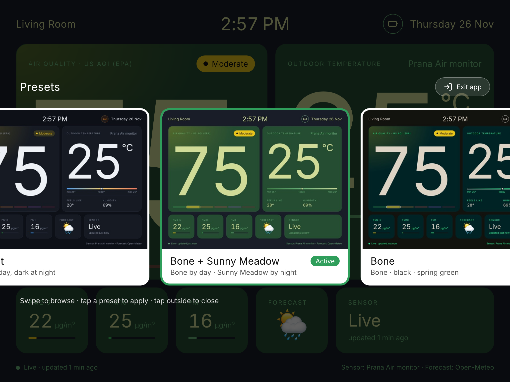</p>

| Preset | Day | Night |
|---|---|---|
| **Default**: traffic-light AQI colours | 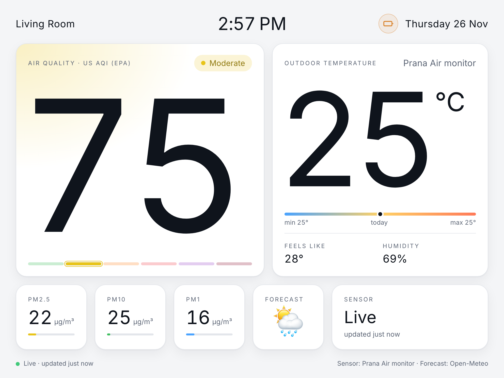 | 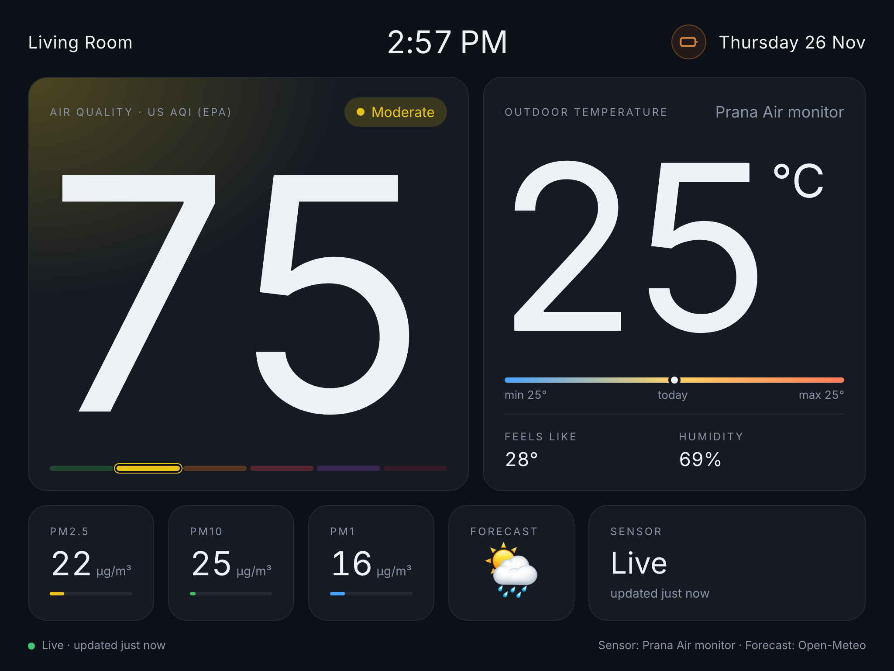 |
| **Bone**: bone, black, spring green | 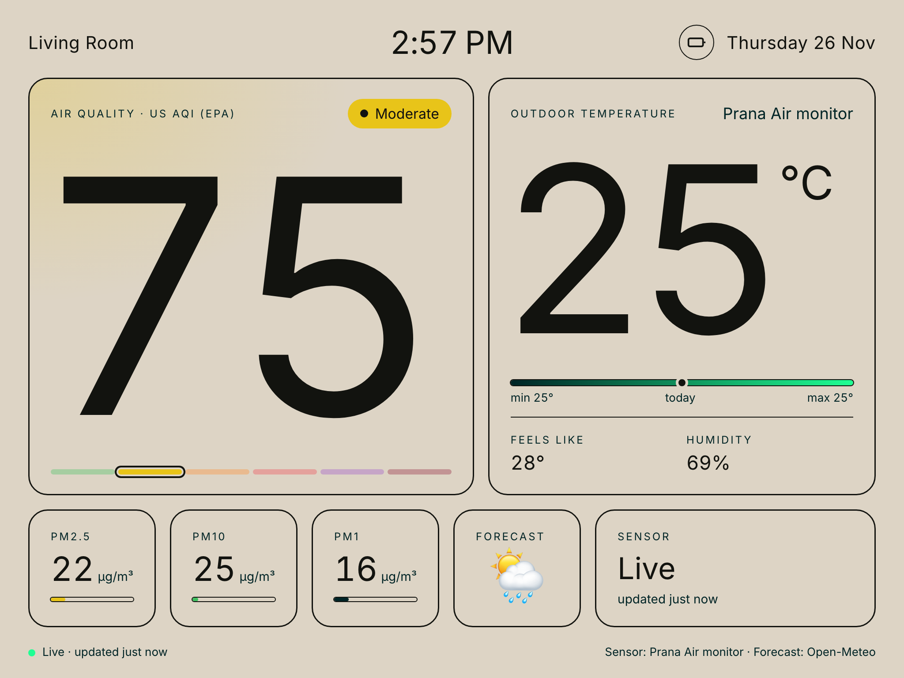 | 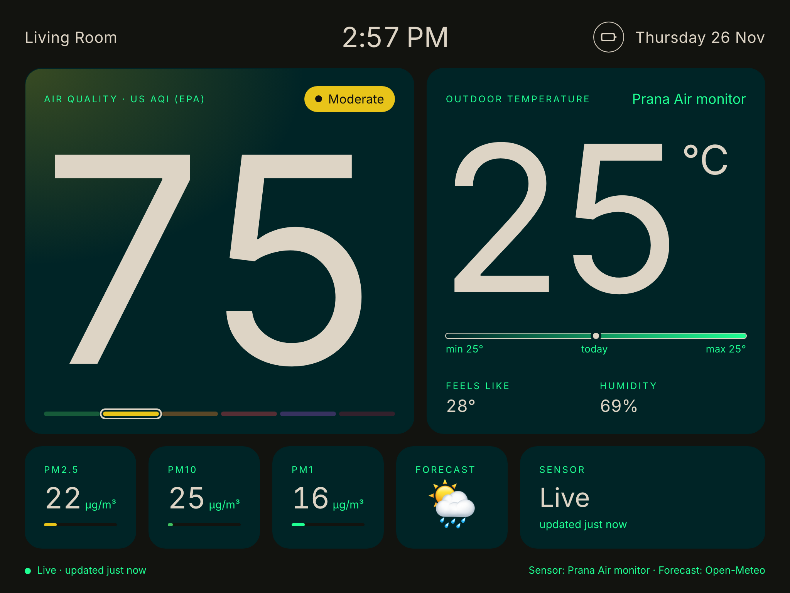 |
| **Sunny Meadow**: vanilla on forest green (night) | |  |
| **Bone + Sunny Meadow**: Bone by day, Sunny Meadow by night |  |  |
| **Plum & Sage**: plum, mauve, sage | 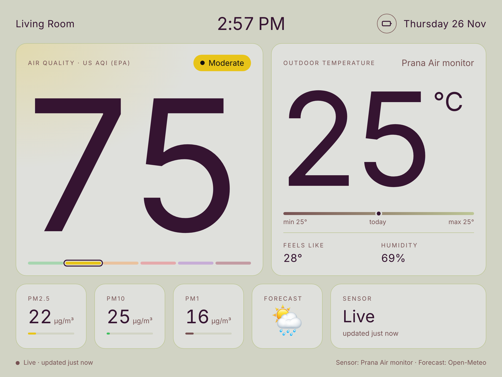 | 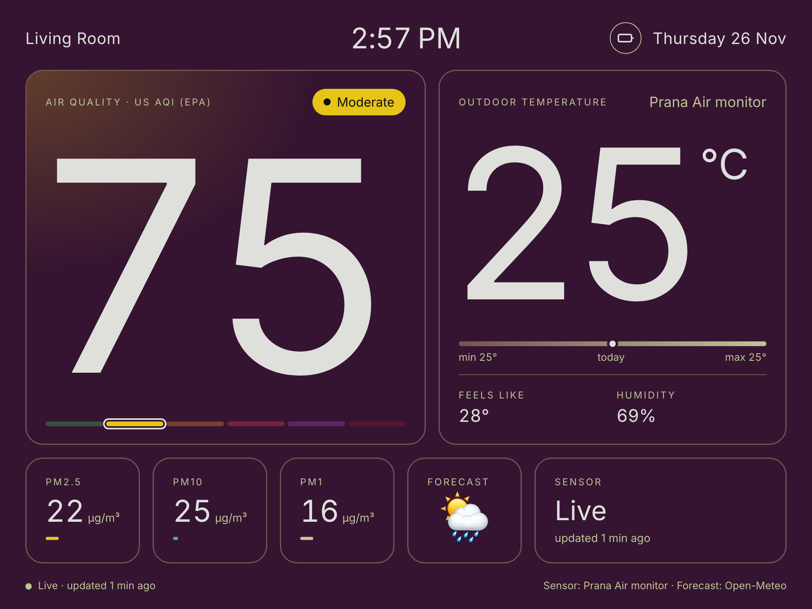 |

Whatever the palette, AQI alert colours always follow the EPA traffic-light scale (green, yellow, orange, red, purple, maroon), so "bad air" never blends into a theme.

To add your own preset, see [docs/presets.md](docs/presets.md). It's one CSS file plus one entry in a JSON list.

## Supported devices

| | Linux tablet / laptop | Android tablet | iPad |
|---|---|---|---|
| Where the server runs | On the tablet | On the tablet (Termux) or another machine | Another machine on your network |
| Full-screen kiosk | Chromium `--kiosk` | Fully Kiosk Browser, or screen pinning | Home Screen web app + Guided Access |
| Starts after power cut | ✅ systemd + autostart | ✅ Fully "launch on boot" | ⚠️ open the web app once after a restart* |
| Brightness slider + auto | ✅ via a brightness daemon | ✅ with Fully PLUS | ➖ iPadOS Auto-Brightness |
| Charging icon | ✅ | ✅ | ➖ (not exposed by iOS) |
| **Exit app** button | ✅ closes the kiosk | ✅ `fully.exit()` | ℹ️ shows how to leave Guided Access |
| Root / jailbreak needed | No | No | No |
| Tested on real hardware | ✅ Xiaomi Mi Pad 2 (Omarchy) | ❌ not yet | ❌ not yet |

<sub>*iPad: after a restart, open the web app from the Home Screen and triple-click to resume Guided Access. The Android and iPad guides follow the platforms' documented features; reports from real devices are welcome.</sub>

## How it works

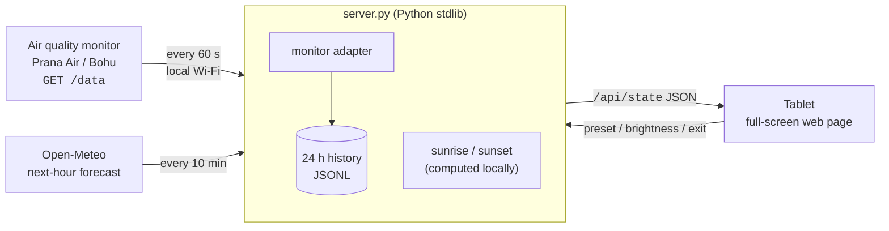

- **The browser never talks to the monitor directly.** Small embedded web servers like this are slow, allow only one connection at a time, and don't send the headers a browser needs to read data from another device. The server polls the monitor, keeps the last good reading, and serves one clean JSON endpoint.
- **Everything is local** except the forecast. If the internet goes down, the air and temperature readings keep updating; only the forecast emoji goes stale.
- **Day and night themes** switch at your local sunrise and sunset, computed from your configured location without any network call.
- **Device controls** (brightness, Exit app) are accepted **only from the tablet itself** (`127.0.0.1`). Changing presets works from anywhere on your network.

## Configuration

`app/config.json` (copy `config.example.json`):

| Key | Example | Meaning |
|---|---|---|
| `home_name` | `"Living Room"` | Shown top-left. Press and hold it to open the presets. |
| `temp_label` | `"Outdoor temperature"` | Label for the monitor's temperature card. |
| `monitor.type` | `"prana"` | `prana` (Prana Air / Bohu HTML page) or `json` (any JSON endpoint). |
| `monitor.url` | `"http://192.168.1.50/data"` | The monitor's local endpoint. |
| `monitor.fields` | `{"pm25": "sensors.pm2_5"}` | For `json`: dotted paths to `pm25`, `pm1`, `pm10`, `temp`, `hum`, `co2`. |
| `monitor.interval_s` | `60` | How often to read the monitor. |
| `location.lat/lon` | `12.97 / 77.59` | City-level is enough. Used for sunrise and sunset and the forecast. |
| `forecast` | `true` | Set to `false` to make no internet calls at all. |
| `brightness` | `{"type": "file", ...}` | Optional: a local brightness daemon ([Linux](deploy/linux#brightness)). |
| `kiosk.exit_command` | `"pkill -f ..."` | Optional: what **Exit app** runs on a Linux kiosk. |
| `listen` | `{"host": "0.0.0.0", "port": 8787}` | Use `127.0.0.1` when the tablet runs its own server. |

**Preview URLs** (handy for screenshots): `/?preset=plum-sage&theme=dark`, or `/?presets=1` to open the picker.

## Credits

- Forecast by [Open-Meteo](https://open-meteo.com) (CC BY 4.0).
- Typeface [Inter](https://rsms.me/inter/) (SIL OFL 1.1).
- Palettes adapted from [Coolors](https://coolors.co).

## License

[MIT](LICENSE). Not affiliated with Prana Air, Xiaomi or Apple.

---

<p align="center">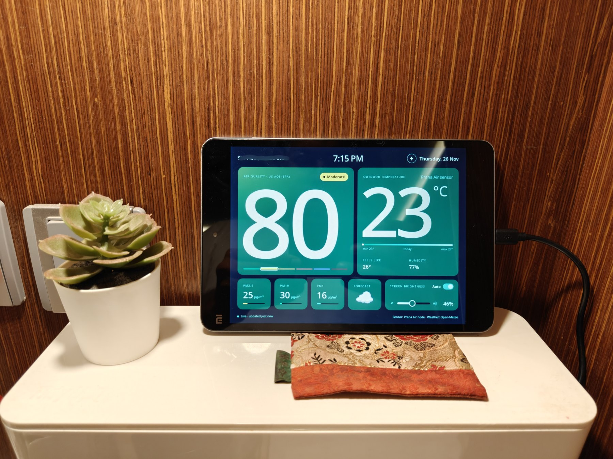</p>
